# prop-twin — JAPAN SCIENTIST AI JAM SESSION 2026 のプロペラ・デジタルツイン

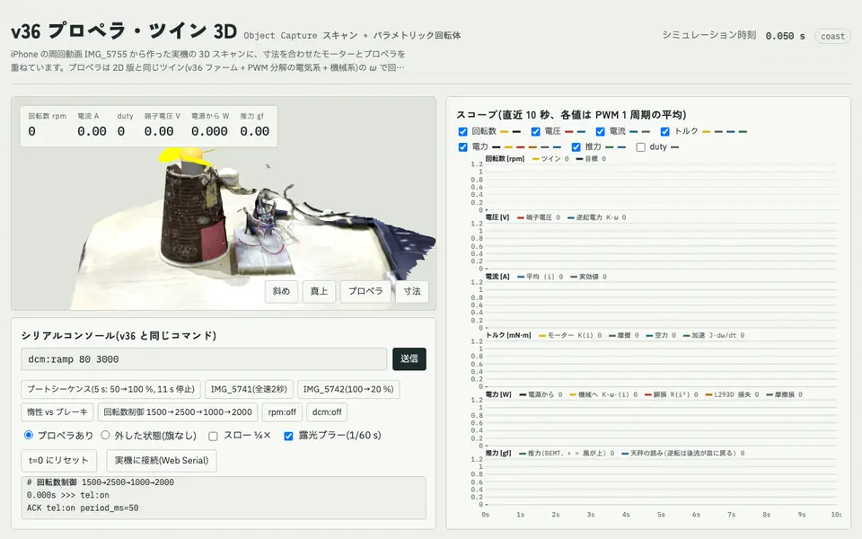

*[`twin/twin3d.html`](twin/twin3d.html) で閉ループ回転数制御 `rpm:set` 1500 → 2500 → 1000 → 2000 rpm を動かしたところ(左:実機の 3D スキャン + プロペラ、右:回転数・電圧・電流・トルク・電力・推力)*

[JAPAN SCIENTIST AI JAM SESSION 2026](https://www.riken.jp/pr/events/lectures/20261027_1/index.html)(理化学研究所 TRIP 事業本部・AGIS 主催)で取り組んだ内容です。2026-10-28(東京・AP日本橋)と 10-29(理研神戸 R-CCS)の本番セッションに両日とも参加し、AI エージェント(Claude Code、Codex)を共同研究者として、机の上の小さな装置のデジタルツインを 2 日間で作りました。

## 成果の概要

| | 内容 |
|---|---|
| **装置** | Switch Science ESPr Developer(ESP8266)+ L293D(2 ブリッジ並列)+ 130 級 DC モーター + 3 枚羽根プロペラ(紙コップ上) |
| **ファーム** | USB シリアル 1 行 1 コマンドの `blink_ota_esp8266_v36.ino`。会期中に、動画同期用 LED、ADC の逆起電力プローブと回転計(`adc:*`)、閉ループ回転数制御(`rpm:set`)、テレメトリ(`tel:on`)を加えました |
| **計測** | iPhone 動画(音声・羽根の追跡)、ESPr の ADC、電子天秤による推力、RealityKit Object Capture の 3D スキャン |
| **ツイン** | PWM 1 周期ごとに解く電気系 + 回転系 + BEMT(翼素運動量理論)の空力。2D / 3D のブラウザ版は Web Serial で実機の値を重ねて表示([`twin/`](twin/)) |
| **主な結果** | K = 6.06e-3 V·s/rad を ADC で直接測定、推力 1.9 gf @ 3164 rpm、部分 duty の 13 観測を ±1.5σ で再現、閉ループで 1000–2500 rpm を ±1 % で保持 |

### 装置と実験の様子

<table><tr>
<td width="62%">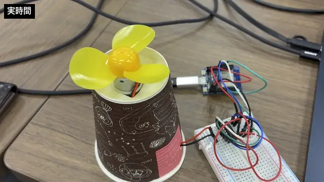</td>
<td width="38%">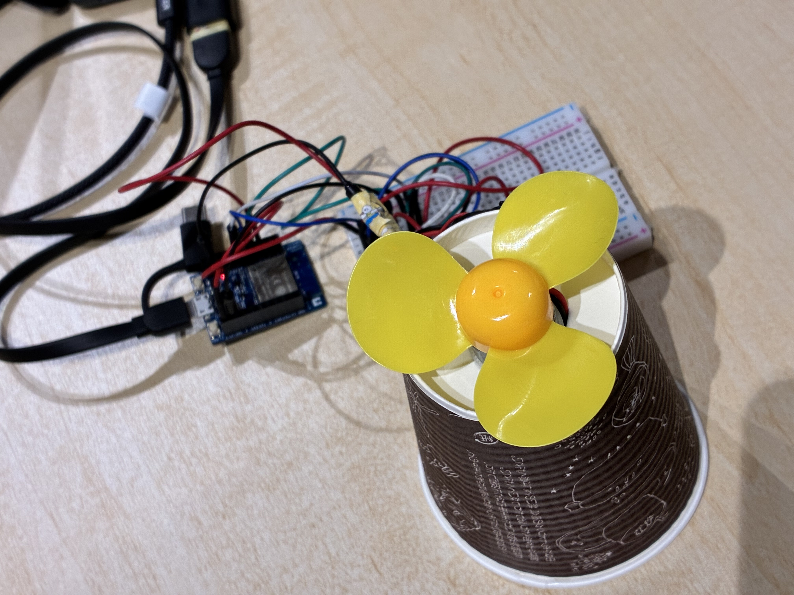</td>
</tr><tr>
<td>IMG_5741:<code>dcm:speed 255</code> を 2 秒 → <code>dcm:off</code> で惰性停止(実時間)。最初の同定に使った動画</td>
<td>真上から(IMG_5754)。紙コップの上に 130 級モーターと直径 64 mm の 3 枚羽根、右がブレッドボードの ESPr と L293D</td>
</tr></table>

紙コップを伏せてモーターを差し込み、軸に玩具のプロペラを付けました。風は上向きに吹き、反作用で装置全体が下に押されるので、電子天秤に載せると推力が「重さが増える」向きに読めます。配線は [`WIRING.md`](WIRING.md)。

<table><tr>
<td width="48%">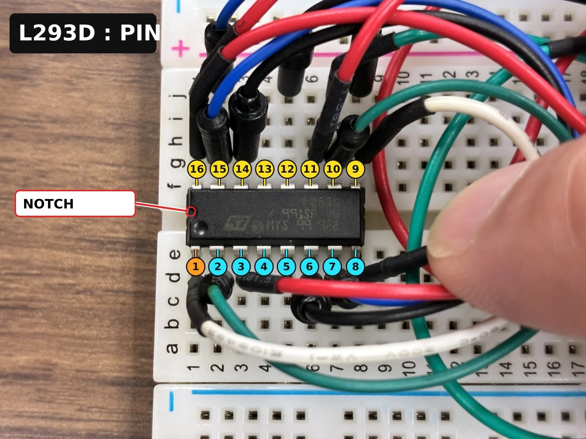</td>
<td><b>組み立て:L293D のピン番号を AI に教わる</b><br><br>ブレッドボードの組み方は AI に教わりながら進めました。「L293D の 16 番・8 番を VOUT へ」と言われても「○番」が分からなかったので尋ねると、ChatGPT の Codex は、ブレッドボードの数字ではなく IC の足の番号であること、切り欠きを左に置くと左下が 1 番で反時計回りに 16 番まで進むことを説明しました。さらに、送った写真にそのまま番号を書き込んだのが左の「L293D ピン番号ガイド」です(1 番ピンはオレンジ、切り欠きは赤丸)。やり取りの詳細は下の<a href="#ai-に教わったことブレッドボードの組み方">AI に教わったこと</a>にあります。</td>
</tr></table>

### ファーム

1 行 1 コマンドのシリアル専用ファームです。会期中に加えたコマンドは次のとおりです(全コマンドは下の[シリアルコマンド一覧](#シリアルコマンド一覧))。

| コマンド | 役割 |
|---|---|
| 同期 LED(IO14) | コマンドの ACK ごとに 100 ms 点灯。動画とホストの送信時刻をフレーム単位で合わせる |
| `adc:cap <us> <n> <pre> [cmd]` | 端子電圧を最大 5 kHz で取り込む(コマンド実行の前後を含めて) |
| `adc:emf [settle_us] [n]` | EN を一瞬切って出力を Hi-Z にし、逆起電力 Kω を読む回転計 |
| `rpm:set <rpm>` / `rpm:off` | 回転計を使った閉ループ回転数制御(フィードフォワード + PI、750–3200 rpm) |
| `tel:on` | 50 ms ごとに `TEL t= duty= rpm= filt= ref=` を送る。ブラウザ版ツインが Web Serial で受けて重ね描き |

### 計測 1:音声の FFT で回転数を読む

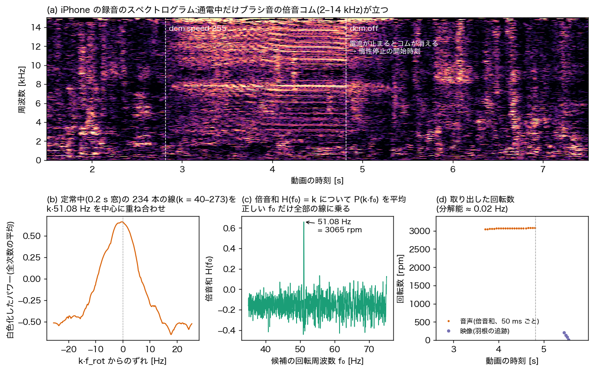

ブラシと整流子の接触は、通電中に回転周波数 f_rot の整数倍(k = 40–270、2–14 kHz)に並ぶ「倍音コム」を出します(a)。全次数の線を k·f_rot を中心に重ねると 1 本の鋭いピークになり(b)、候補 f₀ について k·f₀ のパワーを平均した倍音和 H(f₀) は正しい f₀ だけで突出します(c)。0.2 s 窓を 50 ms ずつずらすと、約 0.02 Hz の分解能で回転数の時系列が取れます(d)。電流が止まるとコムは消えるので、`dcm:off` の瞬間もわかります。低速の惰性の終わりは、映像で羽根の角度を追跡して補いました。コードは [`twin/identify.py`](twin/identify.py)、図は [`analysis/readme/fig_audio_fft.py`](analysis/readme/fig_audio_fft.py)。

### 計測 2:ADC で逆起電力定数 K を直接測る

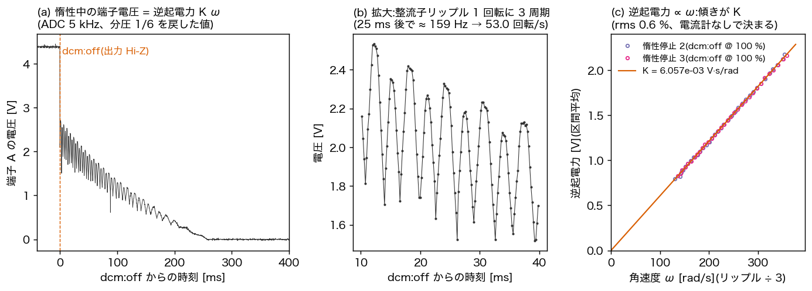

動画だけでは電流も絶対トルクも測れず、K と慣性モーメント J の「比」しか決まりませんでした。そこで端子 A を 10 kΩ / 2 kΩ で分圧して ESPr の ADC(TOUT)に入れ、`dcm:off` 直後を 5 kHz で取り込みました。出力が Hi-Z になると端子に残るのは逆起電力 Kω だけで(a)、3 セグメントの整流子が 1 回転に 3 周期のリップルを乗せます(b)。リップルから ω、区間平均から逆起電力を取ると原点を通る直線になり、その傾きが **K = 6.06e-3 V·s/rad**(rms 0.6 %)です(c)。SI 単位ではこれがそのままトルク定数 N·m/A でもあります。コードは [`twin/adc_backemf.py`](twin/adc_backemf.py)。

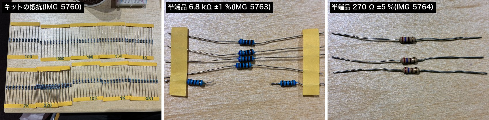

**分圧の抵抗は Claude Code に選んでもらいました。** 端子の電圧(最大 約 3.9 V)を ADC の入力範囲 0〜1 V に下げる分圧抵抗が必要でした。手持ちの抵抗を撮って見せると、Claude Code はキットの抵抗の表示や半端品のカラーコード(青・灰・黒・茶・茶 = 6.8 kΩ ±1 %、赤・紫・茶・金 = 270 Ω ±5 % など)を写真から読み取り、上限 1 V に収まる組み合わせを選びました。最終的な配線は「端子 A → 10 kΩ → TOUT → 2 kΩ → GND、端子 B → 270 Ω → GND」の 3 本です(やり取りの詳細は下の[AI に教わったこと](#ai-に教わったこと手持ちの抵抗から分圧回路を選ぶ))。

### 計測 3:電子天秤で推力を測る

<table><tr>
<td width="30%">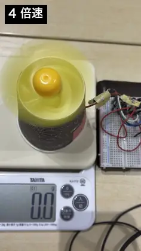</td>
<td>IMG_5785:装置ごと電子天秤に載せて風袋を引き、duty を 100 → 80 → 60 → 50 → 40 % と 6 秒ずつ下げる(4 倍速、2 回)。同時に <code>tel:on</code> で回転数も記録し、各段の後半 4 秒の天秤の読みと回転数を組にしました(<a href="twin/data/thrust_steps_IMG_5785.json"><code>thrust_steps_IMG_5785.json</code></a>)。全速で 1.68 gf。推力は回転数の 2 乗ではなく <b>2.23 乗</b>で増え、低速ほど翼の揚力が効かなくなる(低レイノルズ数での層流はく離)ことがわかりました。</td>
</tr></table>

### 計測 4:3D スキャンと 3 次元モデルの再構築

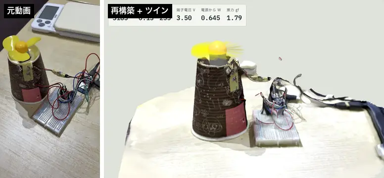

*装置の周回動画 IMG_5755(左、3 倍速)から鮮明な 159 フレームを選び、RealityKit Object Capture でテクスチャ付きメッシュを作りました(右)。机に平面を当てて水平化し、ブレッドボード(82.5 × 54.5 mm)で縮尺を合わせ、紙コップは円錐台(高さ 91.6 mm、口 Ø75.6、底 Ø49.6)で当てはめています。薄く光沢のあるプロペラは再構成できないので、ツインのパラメトリック形状に置き換えて回しています。*


*プロペラ単体を 10 円玉と並べて撮った周回動画 IMG_5778(左、6 倍速)から 230 フレームで再構築(右)。3 回対称になる軸を回転軸として求め、半径ごとの円筒で切った断面から**ピッチ 18°(ねじれなし)**を得ました。直径は 64 mm です(天秤に載せた装置の再スキャン IMG_5782 で、紙コップを基準に縮尺)。弦長は平置き写真の輪郭と 5 % で一致します。これが BEMT の形状の入力です。*

### ツイン:数理モデル

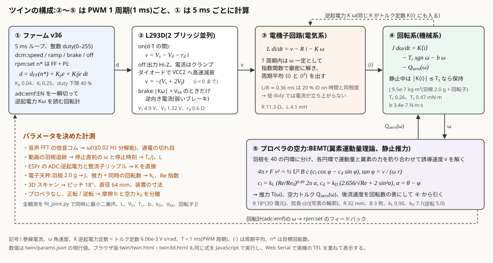

ツインはファーム(①)とモーター・プロペラ(②〜⑤)を 1 本の時間積分で再現します。モーター側は PWM の 1 周期 T = 1 ms ごとに進め、ファームは実機と同じく 5 ms ごとに duty を更新します。

#### 電磁気学的なモデル(永久磁石ブラシ付き DC モーター)

固定子の永久磁石が作る磁場の中で、回転子の巻線に電流 i が流れると、ローレンツ力 **F** = i **ℓ** × **B** が軸のまわりのトルクになります。巻線が磁場の中を回ると、ファラデーの法則で磁束の変化が逆起電力 e を生みます。1 つの巻線について合計すると、どちらも同じ定数 K で書けます。

```math
\tau_m = K\,i, \qquad e = K\,\omega
```

エネルギー保存(電気入力 e·i = 機械出力 τ·ω)から、SI 単位では「トルク定数 [N·m/A]」と「逆起電力定数 [V·s/rad]」は同じ値になります。だから惰性中の電圧と回転数だけで測った K が、そのまま電流からトルクへの換算にも使えます。整流子(3 セグメント)は回転子の 3 つのコイルへの電流を回転に合わせて順に切り替えます。この切り替えが、ADC で見える 1 回転 3 周期のリップル(計測 2)と、ブラシ音の倍音コム(計測 1)の源です。

巻線は抵抗 R とインダクタンス L の直列で、端子電圧 v との関係は次の微分方程式です。

```math
L\,\frac{di}{dt} = v - R\,i - K\,\omega
```

L293D は 1 kHz の PWM で巻線に電圧をかけます。1 周期の中で状態が 3 通りに切り替わるので、それぞれの v を使い分けます。

| 状態 | 期間 | 端子電圧 v | 意味 |
|---|---|---|---|
| on | d·T | V_s − V₀ − r_d·i | 電源 4.9 V から、ドライバのトランジスタの降下 V₀ = 1.32 V と傾き r_d = 0.6 Ω を引いた値 |
| off(EN = LOW) | (1 − d)·T | −(V_s + 2V_f)、i = 0 で終了 | 出力が Hi-Z になり、巻線の電流はクランプダイオード 2 個を通って電源へ戻りながら急速に減る(高速減衰) |
| brake | — | \|Kω\| > V_bk のときだけ逆向き電流 | L293D の上側は電流を吐き出すだけなので、ブレーキは片側の上側とダイオードを通り、V_bk ≈ 3 V を失う弱いブレーキになる |

1 周期の中では ω はほぼ一定(機械の時定数 ≈ 0.3 s ≫ 1 ms)なので、この線形 1 階微分方程式は指数関数で厳密に解けます。

```math
i(t) = a + (i_0 - a)\,e^{-t/\tau_e}, \qquad a = \frac{v - K\omega}{R}, \quad \tau_e = \frac{L}{R} \approx 0.36\ \text{ms}
```

これを on / off の区間ごとに積分して、周期平均の電流 ⟨i⟩(トルクになる)と ⟨i²⟩(銅損 R⟨i²⟩)を求めます。電気の時定数 τ_e は 20 % duty の on 時間 0.2 ms と同程度なので、低 duty では電流がほとんど立ち上がりません。最初に作った「duty で平均した電圧をかける」モデルは 20 % で回り続けると予測しましたが、実機は止まりました。PWM の 1 周期ごとに解くモデルに変えて初めて、この挙動と、30 % で止まり 40 % では回り続ける境目が再現できました。

#### 回転系の運動方程式

回転子とプロペラをまとめた慣性モーメント J について、トルクの釣り合いは次のとおりです。

```math
J\,\frac{d\omega}{dt} = K\langle i\rangle - T_c\,\mathrm{sgn}\,\omega - b\,\omega - Q_\text{aero}(\omega)
```

| 項 | 値 | 意味と決め方 |
|---|---|---|
| J | 9.5e-7 kg·m² | プロペラ 6.9e-7(天秤の 2.0 g × 平置き写真の輪郭から ⟨r²⟩)+ 回転子 2.7e-7(同時同定) |
| K⟨i⟩ | — | モーターのトルク。⟨i⟩ は上の電気系の周期平均 |
| T_c | 0.26 mN·m | ブラシと軸受けのクーロン摩擦(回転数によらない)。惰性停止の最後の減速から |
| b | 3.4e-7 N·m·s | 粘性摩擦(回転数に比例)。部分 duty の回転数とプロペラなしの実験から |
| Q_aero(ω) | BEMT の表 | プロペラの空力トルク。おおよそ ω² に比例 |
| T_s | 0.47 mN·m | 静止摩擦 + コギング。止まっている間は \|K⟨i⟩\| ≤ T_s なら動き出さない(冷間始動の 47 % しきい値から) |

定常回転では左辺が 0 になり、モーターのトルクが摩擦と空力の和に釣り合います。`dcm:off` の後は ⟨i⟩ = 0 なので、摩擦と空力だけで減速して止まります(実験動画の惰性停止)。電気系とつなぐと、機械の時定数はおよそ τ_m ≈ JR/K² ≈ 0.3 s です。

#### プロペラの空力(BEMT)

羽根を半径方向に 40 の円環に分け、各円環で「空気に与えた運動量」と「翼の揚力・抗力」が等しくなる誘導速度 v を解きます(静止推力)。

```math
4\pi r F v^2 = \tfrac12 U^2 B c\,(c_l\cos\phi - c_d\sin\phi), \qquad \tan\phi = \frac{v}{\omega r}, \qquad \alpha = \theta - \phi
```

```math
c_l = k_L \left(\frac{Re}{Re_0}\right)^{0.49} 2\pi\alpha, \qquad c_d = k_D\left(\frac{2.656}{\sqrt{Re}} + 2\sin^2\alpha\right)
```

U は翼素が受ける風の速さ、B = 3 は羽根の数、c(r) は弦長(写真の輪郭)、θ = 18° はピッチ(3D 復元)、F はプラントルの翼端・ハブ損失です。翼は薄い平板として扱い、レイノルズ数 Re = 3×10³〜1.5×10⁴ の低い領域なので、揚力の効きに Re 依存を入れました(指数 0.49 は推力 ∝ n^2.23 の実測から)。推力 T(ω)、空力トルク Q_aero(ω)、後流速度は回転数の表にして、回転系の式から引きます。コードは [`twin/bemt.py`](twin/bemt.py)。

### 主な結果

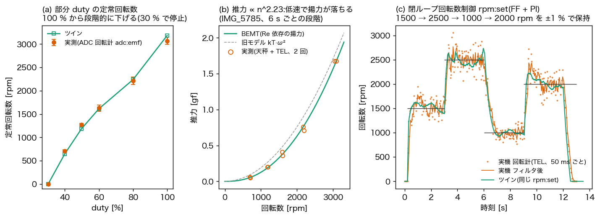

(a) duty を 100 % から段階的に下げたときの定常回転数(ADC 回転計)をツインは誤差範囲で再現し、30 % で止まることも予測どおりです。(b) BEMT は天秤の推力を全速から 40 % まで追い、旧モデル(推力 ∝ ω²)が部分 duty で 15–20 % 大きく出ていた分を直しました。(c) 閉ループ制御 `rpm:set` で 1500 → 2500 → 1000 → 2000 rpm を ±1 % で保持し、同じコマンドを流したツインの応答(立ち上がり・オーバーシュート)も実機と重なります。図は [`analysis/readme/fig_results.py`](analysis/readme/fig_results.py) で、現行の [`twin/params.json`](twin/params.json) から作り直せます。

| 量 | 値 | 根拠 |
|---|---|---|
| K(逆起電力 = トルク定数) | 6.06e-3 V·s/rad | ADC の逆起電力と整流子リップル、2 回の惰性停止、rms 0.6 % |
| R / L | 11.3 Ω / 4.1 mH | 全観測の同時同定(`fit_joint.py`) |
| J | 9.5e-7 kg·m² | 羽根の質量 2.0 g と輪郭 + 回転子 |
| 推力 | 1.9 gf @ 3164 rpm(C_T ≈ 0.34) | 電子天秤(IMG_5769)。回転数を同時に測った IMG_5785 では 1.68 gf @ 3067 rpm、推力 ∝ n^2.23 |
| 部分 duty | 100/80/60/50/40 % = 3070/2216/1628/1269/712 rpm、30 % で停止 | `adc:emf` の回転計。13 観測を ±1.5σ で再現 |
| 閉ループ | 1000–2500 rpm を ±1 % | `rpm:set`(FF + PI) |

## 使った AI エージェント

| エージェント(モデル) | 時期 | 取り組んだこと |
|---|---|---|
| Claude Code(Claude Opus 5.5、デスクトップアプリ) | 10-28 午後〜10-29 | v36 ファームの修正と機能追加、動画・ADC・天秤の解析、ツイン本体と同定、BEMT、2D / 3D のブラウザ版、記録の整理と公開 |
| Codex(GPT-6.1 Sol、VS Code) | 10-28 午前〜10-29 午前 | モーター未接続での USB・通信の立ち上げ、フラッシュの退避、専用 AP 経由の OTA、出力を無効にした制御ロジックの dry-run 14 項目 |
| Hermes Agent + RiVault(GLM-5.3-Flash) | 10-25〜26(会期前の準備)、10-29 | 会期前に ESP32(ELEGOO キット)と ESPr Developer のシリアル接続・書き込み・OTA の手順を確立し、FLIR サーモカメラで Mac の発熱を記録。10-29 にその作業記録を学習データ用に書き出し(秘密情報・LAN IP・SSID をマスク) |

### AI に教わったこと:ブレッドボードの組み方

ブレッドボードの配線そのものも AI に教わりました。1 日目の朝(10-28 09:43)、ChatGPT の Codex(クラウド)に部品の写真を見せて相談していたとき、「L293D の 16 番・8 番を VOUT へ」という指示の「○番」が何を指すのか分かりませんでした。そう尋ねると、Codex は次のように説明しました。

- 「○番」は IC の金属の足(ピン)の番号で、ブレッドボードに印刷された数字とは別のもの
- 半円形の切り欠きを左にして置くと、左下の足が 1 番で、上から見て反時計回りに 16 番(左上)まで進む

さらに「先ほど送った写真に図式してください」と頼むと、送った L293D の写真そのものに 1〜16 番の番号を書き込んだ「L293D ピン番号ガイド」の画像を作ってくれました(1 番ピンをオレンジ、切り欠きを赤丸で表示。画像は上の[装置と実験の様子](#装置と実験の様子))。続けて「10 番と 15 番から伸びているジャンパ線はどうするのか」と聞いたときも、L293D にはモーター 1 台分の回路が 2 組(A 側:入力 2・7、出力 3・6、許可 1 / B 側:入力 10・15、出力 11・14、許可 9)あることを表で示しました。さらに、今の配線を確かめるまで変更を保留するよう止めてくれました。現在の配線は [`WIRING.md`](WIRING.md) にあります。

### AI に教わったこと:手持ちの抵抗から分圧回路を選ぶ

2 日目の朝(10-29 10:14)、「ESPr の ADC を活用する方法はありますか?」と尋ねると、Claude Code は惰性中のモーター端子に出る逆起電力 Kω を測る方法を提案しました。L293D の出力が Hi-Z になる惰性中なら、端子電圧がそのまま K × 回転数になるからです。最初の回路図は 47 kΩ / 10 kΩ の分圧でしたが、そこから手持ちの部品に合わせて次のように詰めていきました。

1. **キットの写真から選ぶ**:47 kΩ がキットにないので、10 kΩ ×3 と 5.1 kΩ ×2 の 5 本で同じ比を作る案。
2. **本数を減らしたい**:「使う抵抗の本数を減らすことはできますか?」に対し、10 kΩ と 2 kΩ で分圧比 2/12 = 0.167 の 3 本版。駆動中の最大約 3.7 V でも ADC では 0.62 V に収まり、ADC から見た抵抗も小さくなって速い読み取りに向く、と理由も添えて提案しました。
3. **半端品も見せる**:写真のカラーコードを読み、6.8 kΩ(±1 %)6 本、470 Ω(±1 %)4 本、270 Ω(±5 %)3 本と判定しました。1 本目の帯が黄緑に見えるものは「緑なら 570 Ω だが規格にない値なので黄」と判断しています。
4. **自分の設計ミスを直す**:実際に測ると、惰性中の電流が端子 B 側の基準抵抗(6.8 kΩ)を通って全体の約 36 % の電圧が落ち、正しく測れていませんでした。Claude Code はこれを「私の設計ミス」と説明し、270 Ω に替えれば損失は約 2 % で、しかも一定の割合なので計算で補正できる、と直し方を示しました。

こうして組んだ 3 本の分圧回路で、惰性中の逆起電力と整流子リップルを ADC だけで取り、K = 6.06e-3 V·s/rad を直接測れました(計測 2)。配線は [`WIRING.md`](WIRING.md)。

10-29 には、これら 3 種類のエージェントの作業記録をまとめて、Nemotron 3.5 Lightning 30B-A3B と Super VL を rikyu(GB200)で LoRA 微調整し、このツイン上で実機操作を模した課題で評価する実験も行いました(結果は [2 日目の日報](docs/daily/2026-10-29.md))。

経緯は [`docs/HISTORY.md`](docs/HISTORY.md)、日ごとの要約は [1 日目 10-28](docs/daily/2026-10-28.md)・[2 日目 10-29](docs/daily/2026-10-29.md) にあります。

## 開発の記録

2026-10-28〜29 に、動画・ADC・電子天秤で測りながらデジタルツインを作った経緯を [`docs/HISTORY.md`](docs/HISTORY.md) にまとめています。日ごとの要約は [`docs/daily/`](docs/daily/)(例:[2026-10-28](docs/daily/2026-10-28.md)、[2026-10-29](docs/daily/2026-10-29.md))。

| フォルダ | 内容 |
|---|---|
| [`docs/`](docs/) | 開発の記録(時系列、使った動画とコード、主な数値の移り変わり) |
| [`media/`](media/) | 写真と図。動画・3D スキャン・作業用フォルダは GitHub のリリース `media-2026-10-29` に添付(一覧と取得方法は `media/README.md`) |
| [`analysis/`](analysis/) | 作業中に書いた解析コード(1 日目と 2 日目) |
| [`transcripts/`](transcripts/) | Claude Code との会話の記録(個人情報は伏せ字) |

## ファイル構成

| ファイル | 内容 |
|---|---|
| `blink_ota_esp8266_v36.ino` | ファームウェア本体(v36、約230行) |
| `WIRING.md` | L293D 配線ガイド(ピン対応表・電源・実測しきい値) |
| `tools/serial_console.py` | Mac 側シリアルコンソール(モニタ/コマンド送信) |
| `twin/` | デジタルツイン(電気+機械モデル、動画からのパラメータ同定、可視化 `twin.html`)。[twin/README.md](twin/README.md) |

## ハードウェア

| 名称 | 仕様 |
|---|---|
| ボード | ESPr Developer(ESP-WROOM-02、2MB flash、FT231XS USB-serial) |
| モータードライバ | L293D(**2ブリッジ並列**、連続1.2A / ピーク2.4A) |
| モーター | DCモーター(3-6V 級) |
| 電源 | 5V(L293D VCC1/VCC2 と ESPr への給電) |

ピン割り当てと配線の詳細は [WIRING.md](WIRING.md) を参照してください。

## クイックスタート

```bash
# 1. ビルド(Arduino CLI + esp8266 コア 3.1.2)
arduino-cli compile --fqbn "esp8266:esp8266:generic:eesz=2M512,ip=lm2f" \
  --build-path build blink_ota_esp8266_v36

# 2. シリアル書き込み(データ対応USBケーブル必須、約20秒)
arduino-cli upload --fqbn "esp8266:esp8266:generic:eesz=2M512,ip=lm2f" \
  --input-dir build -p /dev/cu.usbserial-XXXX blink_ota_esp8266_v36

# 3. シリアルコンソールで操作
python3 tools/serial_console.py                       # モニタ([HB]確認)
python3 tools/serial_console.py -c stat               # 状態表示
python3 tools/serial_console.py -c "dcm:ramp 80 5000" # 0→80%を5秒でランプ
python3 tools/serial_console.py -c "dcm:off"          # 停止
```

ポート名は `ls /dev/cu.usb*` で確認(FT231XS は `usbserial-DN…` 形式)。

## ピンマップ

| ESP8266 GPIO | L293D ピン | 役割 |
|---|---|---|
| IO12 | 2, 10(1A/3A) | 方向A(正転) |
| IO13 | 7, 15(2A/4A) | 方向B(逆転) |
| IO15 | 1, 9(EN1,2/EN3,4) | PWM 速度 0-255 |
| IO14 | —(同期 LED) | `dcm:*` が受理されるたびに 100 ms 点灯(IO14→抵抗→LED→GND) |

- `dcmApply()` は INA/INB の片方を HIGH、他方を LOW にして方向を決め、EN に `analogWrite()` で duty を出します。
- IO15 はブート時 LOW が必要なストラップピンですが、アイドル状態(`dcmOff()`)が EN=LOW なので整合します。PWM 実績のあるピンです(v31-34で検証済み)。
- IO1/IO3 はシリアル(TX/RX)で使用、IO16 は ESP8266 で PWM 非対応のため EN には使えません。

## シリアルコマンド一覧

| コマンド | 動作 | 引数範囲(コードでクランプ) | 応答例 |
|---|---|---|---|
| `stat` | ヒープ・断片化を表示 | — | `STAT blink_ota_esp8266 v36 serial-only (L293D + sync LED) heap=51256 maxfree=51256 frag=0` |
| `dcm:ramp <pct> <ms>` | 現在の duty から pct% へ ms ミリ秒かけて連続ランプ | pct 0-100 / ms 0-30000 | `ACK dcm:ramp 80% over 5000ms (duty 51->204)` |
| `dcm:ramp-step <pct> <ms> <inc>` | 階段状ランプ(ms間隔で inc% ずつ目標へ増減) | pct 0-100 / ms 50-10000 / inc 1-51 | `ACK dcm:ramp-step target=80% every=1000ms inc=10% (duty 51->204)` |
| `dcm:speed <-255..255>` | 即時設定。符号=方向、0=コースト | -255..255 | `ACK dcm:speed dir=1 duty=204` |
| `dcm:brake` | 短絡ブレーキ(両入力 HIGH + EN=255)。duty は 0 扱い | — | `ACK dcm:brake` |
| `dcm:off` | コースト(EN LOW)。ランプ停止 + duty=0 リセット | — | `ACK dcm:off` |
| `adc:read` | ADC を1回読む | — | `ADC raw=14 tout_mV=13 terminalA_mV=76` |
| `adc:cap <us> <n> <pre> [cmd]` | ADC を us 間隔で n 点 RAM に記録、pre 点目で cmd を実行、終了後に `ADC ...` 行で出力 | us ≥ 10、n ≤ 4000、n·us ≤ 3 s | `ADC cap n=4000 interval_us=200 pre=500 ...` |
| `adc:emf [settle_us] [n]` | 回転計:EN を settle_us(既定 1500)切って電流を消し、端子A(= 逆起電力)を n 回読んで PWM を戻す。どの duty でも使える | settle 200–20000、n 1–64 | `EMF terminalA_mV=1150 raw_mean=196.0 ... coast_us=1846 duty=153 drive` |
| `rpm:set <rpm>` | 回転数の閉ループ制御(750–3200 rpm)。停止中なら 100 % でキックして起動。0 で停止。`dcm:*` を送ると解除 | 750–3200 | `ACK rpm:set ref=1500` |
| `rpm:off` | 制御を止めてコースト | — | `ACK rpm:off` |
| `tel:on` / `tel:off` | 50 ms ごとに回転計で測って `TEL` 行を出力(制御中でなくても可) | — | `TEL t=12345 duty=150 rpm=1523 filt=1497 ref=1500` |
| `adc:zero` | モーター停止中に ADC のゼロ点を測り直す(起動時にも自動) | — | `ACK adc:zero raw=21.1` |
| `dcm:auto <0\|1>` | ブートシーケンスの ON/OFF(実行中に 0 にすると即停止) | — | `ACK dcm:auto boot-soft-start=OFF` |

未定義コマンドには `ERR unknown cmd '...' (stat|dcm:*)` が、`dcm:ramp` / `dcm:ramp-step` の引数不足には `ERR ... usage: ...` が返ります。

### 動作上の規則

- **連続ランプと階段ランプは相互排他**。どちらかを開始すると他方はキャンセルされます。`dcm:speed` / `dcm:brake` / `dcm:off` もランプをキャンセルします。
- `dcm:off` は duty を 0 に戻すため、**次のランプは必ず 0 から始まります**(停止後に途中の duty が残るバグは v34 で修正済み)。
- `dcm:ramp` / `dcm:ramp-step` は**方向を変更しません**(現方向のまま duty を変える)。逆転は先に `dcm:speed -N`(または `-N` からの階段)を使います。
- `dcm:brake` 後のランプも **0 から始まります**(ブレーキ中は duty=0 として扱う)。
- `dcm:ramp-step` は目標が現在 duty より低ければ inc% ずつ**減速**します。
- ブートシーケンスは **起動5秒後に 50% で始動 → 5秒かけて 100% → 1秒ホールド → コースト(停止)** です。50% は停止状態から起動できる最低 duty です。途中で `dcm:speed` などの操作コマンドを送るとシーケンスはキャンセルされ(以後の停止も行わない)、`dcm:auto 0` を送ると即停止して無効化します。**RAM 保持のため再起動すると ON に戻ります**。
- `[HB] <millis>` を500msごとに出力(ループ生存確認用)。これが途絶えたらフリーズかリセットです。

## ブートシーケンス(正常系のログ)

```
[RESET] External System
[FW] blink_ota_esp8266 v36 serial-only (L293D + sync LED)
[DCM] L293D ready (EN=IO15 PWM, 1A+3A=IO12, 2A+4A=IO13)
[DCM] boot sequence armed: in 5s, 50->100% over 5s, hold 1s, coast (dcm:auto 0 to disable)
Ready. Type a command (stat | dcm:speed 255 | dcm:ramp 80 5000 | ...)
[HB] 5012 ...
[DCM] boot sequence: 50% -> 100% over 5s
[HB] 10020 ...
[DCM] boot sequence done: coast
[HB] 11025 ...
```

v36 は Wi-Fi を持たないため、**書き込み直後から即座に**このシーケンスが始まります。

## 実測データ(このモーター+ドライバーでの測定値)

### 冷間始動しきい値(二分探索で実測)

| duty | 結果 |
|---|---|
| 20% | 不転 |
| 40% | 不転 |
| **45%** | **境界**(遅れて breakaway) |
| 50% | 転 |
| 60% / 100% | 転 |

- **確実な起動 = 50%以上、安定運転 = 55%以上**を推奨。
- **維持しきい値は起動しきい値より低い**(未測定)。回転中にしきい値未満へ落とすと、逆起電力が実効電圧を上回り減速・停止します。
- L293D の電圧降下は 1.4-2.6V。20% duty では実効 ~0.5V しかかからず、3-6V モーターは起動できません(上記しきい値の物理的理由)。

### リソース使用量(v36 実測)

| 項目 | 値 |
|---|---|
| bin サイズ | 282,992 B(OTAスロット ~768KB の約37%) |
| RAM(グローバル/静的) | 29,212 / 80,192 B(36%) |
| 起動時ヒープ | 51,256 B(frag 0%) |

## ビルド設定の意味

| FQBN オプション | 意味 |
|---|---|
| `generic` | 現行 esp8266 コアに ESPr Developer 専用定義はないため Generic ESP8266 Module を使用 |
| `eesz=2M512` | 2MB flash、FS 512KB → スケッチ+OTA領域 ~1.5MB(2スロット各 ~768KB) |
| `ip=lm2f` | lwIP v2 Lower Memory(Wi-Fi コードが無いため動作への影響なし) |

- シリアル書き込みは RTS ハードリセットで自動的にブートローダーへ入り、書き込み後にハッシュ検証されます(115200 baud で 283KB ≈ 20秒)。
- 書き込みはブートローダー+アプリ領域のみを上書きします。

## トラブルシューティング

| 症状 | 確認点 |
|---|---|
| モーターが回らない | ACK の duty を確認 → 50%未満の冷間始動は不転の可能性(55%+で再試験)。VCC1/VCC2 が 5V か、GND 共通か、ジャンパ(1↔9 / 2↔10 / 7↔15)を WIRING.md で確認 |
| 低速で失速する | 実測しきい値以上か確認。維持は起動より緩いが、極端な低速は電圧降下で不可 |
| 途中でリセット/[HB] 途絶 | 電源容量不足の典型。モーターを別 5V 電源にし GND を共通化 |
| `/dev/cu.usb*` が出ない | データ対応ケーブルか確認(給電専用ケーブルは通信不可)。再挿入で復帰するか試す |
| 書き込みがタイムアウト | ケーブル再挿入のうえ再実行。`arduino-cli upload` は RTS 自動リセットするためボタン操作は不要 |
| コマンドが無反応 | `[HB]` が出ているか確認。出ていれば受信側(ケーブル/アプリ)の問題、出ていなければボード側 |
