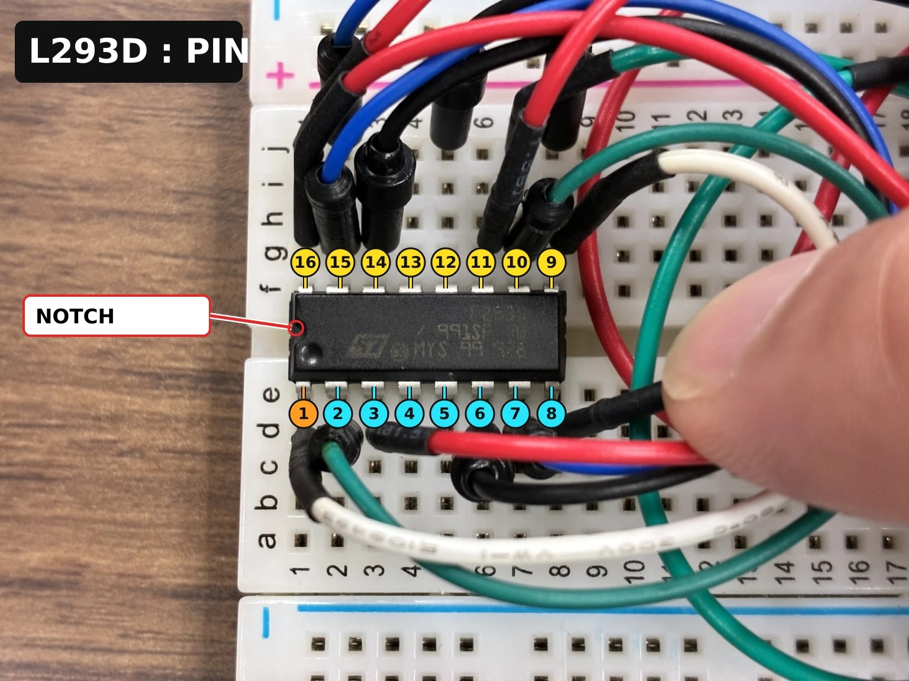
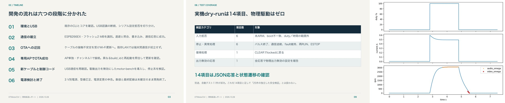

# PropTwin 開発日報 2026-10-28

[JAPAN SCIENTIST AI JAM SESSION 2026](https://www.riken.jp/pr/events/lectures/20261027_1/index.html) 本番セッション 1 日目(東京・AP日本橋)の取り組み。

## 概要

ESPr Developer(ESP8266)+ L293D + 130 級 DC モーターの装置を、午前は Codex(DTMotorCtrl プロジェクト)でモーターを回さずに通信と安全側の制御ロジックから立ち上げ、午後は Claude Code でシリアル専用ファーム v36 を整えて実際に回し、iPhone の動画から最初のデジタルツインを作った。1 kHz PWM を 1 周期ごとに解くモデルにしたことで、20 % duty で止まる挙動を再現できるようになった。

## 実施内容

**A. 午前〜:Codex で通信と制御ロジックの立ち上げ**(10:52 開始、モーター未接続)

| 段階 | 内容 |
| --- | --- |
| 0. 配線を教わる(09:43〜、ChatGPT の Codex クラウド) | 部品の写真を見せて相談。「L293D の○番」が IC の足の番号(切り欠きを左に置くと左下が 1 番、反時計回りに 16 番)だと教わり、写真に番号を書き込んだ「L293D ピン番号ガイド」を作ってもらった。2 組あるブリッジ(A 側 1–8 番、B 側 9–16 番)の役割も表で説明を受けた |
| 1. 環境と USB | 既存の Arduino CLI 1.5.1 / ESP8266 core 3.1.2 を確認。USB 認識の断続とシリアル設定の拒否を切り分け |
| 2. 通信の確立 | ESP8266EX・26 MHz・フラッシュ 2 MB を識別。元のフラッシュ全体を退避・照合してから通信専用ファーム `comm-check-0.1.0` を書き込み、HELLO / PING / STATUS の往復に成功 |
| 3–4. OTA | ケーブルの接触不安定を受けて Wi-Fi 更新へ。既存 LAN では端末間通信が通らず、ESPr 専用の AP 経由で OTA 更新に成功(build_id と再起動で確認) |
| 5. 制御コード | 駆動出力を無効にした `motor-bench-0.1.0` を導入し、起動ロック・通信途絶時停止・異常保持・非常停止など実機 dry-run 14 項目と自動テスト 11 件に成功 |
| 6. 電源検討 | 3 V 別電源、モーター型番の訂正(FA-130 と同外形の別モーター)、配線確認表を作成。開発経過をスライドとレポートにまとめた |

*Codex が部品の写真に書き込んでくれた「L293D ピン番号ガイド」(切り欠きを左に置くと左下が 1 番、反時計回りに 16 番まで)*

**B. 午後:Claude Code で v36 ファームと動画からのツイン**(15:25 開始)

| 時刻 | 内容 |
| --- | --- |
| 15:25 | 既存の v36(シリアル専用)のブレーキ・ランプ引数・階段ランプの向きなどの不具合を修正して書き込み |
| 15:33 | 全速 2 秒の動画 `IMG_5741` から、ブラシ音の倍音(音声)と羽根の追跡(映像)で回転数を取り出し、惰性停止から摩擦と空力を同定 |
| 16:03 | 「20 % で回り続ける」予測が外れて実機は停止 → 1 kHz PWM の 1 周期ごとに電流を厳密に解くモデルへ(L/R ≈ 0.35 ms) |
| 16:11 | 同期用 LED(IO14)、ホスト側の送信時刻ログ、Mac の Tink 音で動画とコマンドを同期。`IMG_5742`(100 → 20 %、60 fps)から巻線インダクタンス L |
| 16:47–17:00 | 電流を測らずに J と K を求める試み:惰性とブレーキの比較、1 円玉で慣性を足す実験(振動が大きく不採用) |
| — | ブラウザで同じファームを動かす 2D ツイン [`twin/twin.html`](../../twin/twin.html) |

*左から:Codex での開発の 6 段階、実機 dry-run 14 項目の内訳、`IMG_5741` の再現(上から duty・電流・回転数、点は音声と映像から取った実測)*

## この日の到達点

- ツインのパラメータは動画のみから:K = 2e-3(事前値)、R = 3.6 → 5.4 Ω、空力は c·ω²
- 低 duty では電流がほとんど立ち上がらない(20 % で起動時 ⟨i⟩ ≈ 0.04 A、PWM 平均モデルなら ≈ 0.13 A)ことがモデルで説明できた
- 残った課題:K と J を電流なしで分けて決めること → 2 日目に ADC の逆起電力測定とプロペラを外した実験で解決([2026-10-29](2026-10-29.md))

出典:[`docs/HISTORY.md`](../HISTORY.md)、[`transcripts/day1_2026-10-28_29.md`](../../transcripts/day1_2026-10-28_29.md)、DTMotorCtrl の保存データ(Codex の会話記録と開発経過レポート、このリポジトリには含めていない)。
