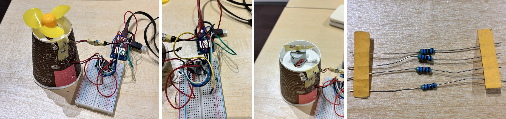
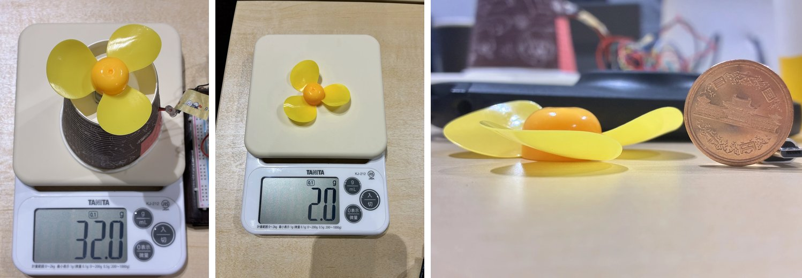
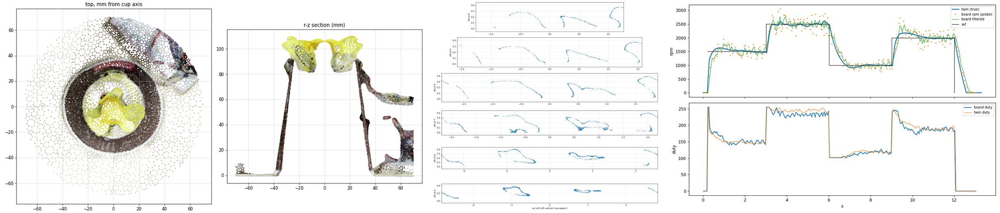

# PropTwin 開発日報 2026-10-29

[JAPAN SCIENTIST AI JAM SESSION 2026](https://www.riken.jp/pr/events/lectures/20261027_1/index.html) 本番セッション 2 日目(2026-10-29)の取り組み。

## 概要

本日は (1) 実機モーター・プロペラのデジタルツインの精度向上と、(2) PropTwin の作業記録で LLM を LoRA 微調整する実験の 2 本を進めた。ツインは ADC で逆起電力定数 K = 6.06e-3 V·s/rad を直接測り、BEMT(翼素運動量理論)の空力モデルを組み込んだ。LLM は段階 3(ツイン試行データを追加)で Lightning のツイン課題の成功率が 51.6 % → 56.2 % に上がった。

## 実施内容

**A. モーター・プロペラのデジタルツイン**(ESPr Developer + L293D + 130 級 DC モーター + 3 枚羽根)

| 時刻 | 内容 |
| --- | --- |
| 09:00–09:44 | ブートシーケンス変更、Object Capture で装置を 3D スキャン(159 フレーム)、プロペラ 2.0 g と弦長分布から慣性 J |
| 10:13–11:22 | ADC 逆起電力プローブを配線し、整流子リップルから K を直接測定 |
| 11:31–12:26 | 天秤で推力測定、回転計 `adc:emf`、閉ループ回転数制御 `rpm:set`、テレメトリ `tel:on`、Web Serial で実機値をツインに重ね描き |
| 13:52–14:15 | プロペラ単体を 3D 復元しピッチ 18° を得て BEMT を実装(Python / JS) |
| 14:55–15:15 | 正転・逆転、プロペラなしの比較。前日の無負荷回転数の差はテープの旗の空気抵抗と判明 |
| 15:53– | 回転数と推力を同時に測り直し、揚力に Re^0.49 依存を入れて再同定。GitHub `prop-twin` に公開 |

*装置全体(紙コップ上のモーターとプロペラ)、ESPr + L293D の配線、プロペラを外した状態、ADC 分圧用に選んだ抵抗*

*電子天秤での推力測定、プロペラ質量 2.0 g、10 円玉と並べたプロペラ側面(ピッチ推定)*

**B. LLM 微調整**(rikyu GB200、Nemotron 3.5 Lightning 30B-A3B と Super VL の LoRA)

- Hermes / Claude Code / Codex / ChatGPT の作業記録から学習データ 187 窓(約 235 万トークン、画像 122)を作成。LAN IP・秘密情報・SSID をマスク
- ツイン上で実機操作を模した評価環境 `twinbench`(8 課題×8 seed)と NLL 評価を整備
- 段階 0–4 を学習・評価し、段階 5(追加 4 課題の教師試行)を実行中

## 検証結果

**ツイン**:推力 1.9 gf @ 3164 rpm。部分 duty の 13 観測を ±1.5σ で再現し、閉ループで 1000–2500 rpm を ±1 % で保持。推力は回転数の 2.23 乗で、旧モデルは部分 duty で 15–20 % 過大だった。現行値は K 6.06e-3、R 11.3 Ω、kL 0.90×(Re/Re₀)^0.49、kD 7.1(逆転 5.0)。逆転はモーター単体で 2.19 % 遅いが、空力負荷は逆転のほうが軽い。

*左から:装置スキャンの上面図と断面、プロペラ単体の半径ごとの断面(ピッチ 18°)、閉ループ制御の実機とツインの比較(上:回転数、下:duty)*

**LLM(twinbench E1 成功率、NLL は低いほど良い)**

| モデル・段階 | E1 全体 | E1 未知 2 種 | 未見セッション NLL | 一般 NLL |
| --- | --- | --- | --- | --- |
| Lightning 元モデル | 51.6 % | 18.8 % | 1.615 | 0.799 |
| Lightning 段階 2(言い換え・Q&A) | 1.6 % | 0.0 % | 1.288 | 0.393 |
| Lightning 段階 3(+ツイン試行) | 56.2 % | 18.8 % | 1.282 | 0.394 |
| Lightning 段階 4(長い思考を除去) | 54.7 % | 12.5 % | 1.336 | 0.393 |
| Super VL 元モデル | 79.7 % | 81.2 % | 1.060 | 0.559 |
| Super VL 段階 2 | 26.6 % | 31.2 % | 1.022 | 0.527 |

記録だけの学習(段階 0–2)は NLL を下げる一方、課題を最後まで完了できない失敗(未完了 34–46 件)が増えた。ツイン試行を加えた段階 3 で未完了は 0 件になった。

## 課題と次のステップ

- [ ] 温度モデル:全速回転数が 51.3 → 48.6 Hz と下がるドリフトを銅損と R(T) で同定
- [ ] ADC 校正:テスターで端子電圧と VCC2 を測り、V0 と R を分離(kD・b・R が打ち消し合う)
- [ ] 低速(40 %)でツインの回転数が 9 % 遅い点の原因調査
- [ ] 天秤の置き方を変えて逆転の推力を測る
- [ ] LLM:段階 5 の結果確認。残る失敗は「RESULT 行なし」(16–18 件)が中心で、Super VL は微調整で元モデルより下がっている

出典:[`docs/HISTORY.md`](../HISTORY.md)、PropTwin 側の `llm_finetune/eval`(`twinbench/report.py` で集計)。
